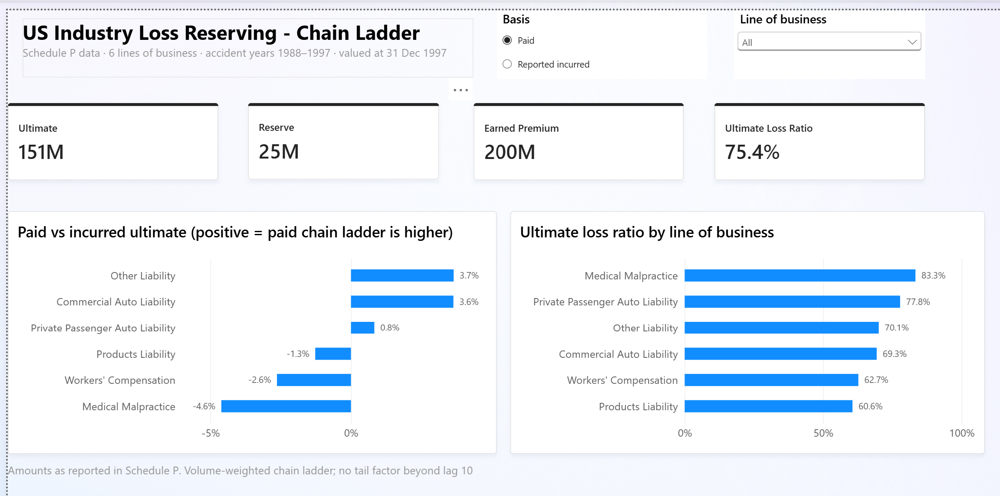
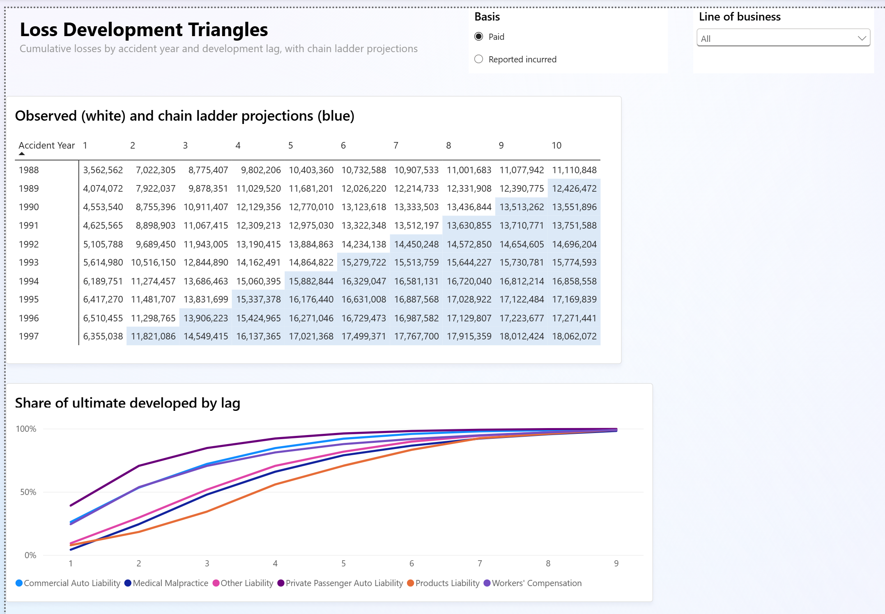

# Loss Reserving Dashboard: Chain Ladder on US Schedule P Data

An end-to-end reserving workflow built on the CAS Loss Reserving Database: data extraction in Python, data quality checks in SQL (DuckDB), chain ladder projections in Python, and a Power BI dashboard.



## At a glance

- **Data:** 775 company × line pairs from NAIC Schedule P, 6 lines of business, accident years 1988–1997, valued at 31 Dec 1997
- **Data quality:** 422 pairs pass all checks and cover **98.4%** of earned premium
- **Method:** volume-weighted chain ladder on paid and reported incurred losses, by line of business
- **Control:** paid development factors computed in Python reconcile exactly with an independent SQL calculation
- **Result:** industry ultimate of 150.7M and reserve of 24.6M on the paid basis (ultimate loss ratio 75.4%)

## Pipeline

```
export_data.py        run_sql.py                    chain_ladder.py        Power BI
CAS data (chainladder) -> data quality + aggregation -> chain ladder by line -> 4-page dashboard
                         (DuckDB SQL)                   + SQL reconciliation
```

## Data quality

Following Meyers & Shi (2011), only company × line pairs with complete 10×10 triangles are kept.

| Check | Pairs flagged | Action |
|---|---|---|
| Incomplete triangle (< 55 cells) | 304 | Excluded |
| Zero or negative earned premium | 82 | Excluded |
| Negative cumulative paid | 41 | Excluded |
| Negative incurred | 20 | Excluded |
| Cumulative paid decreases between lags | 367 | Reported only |
| **Included in analysis** | **422 of 775** | |

A pair can fail more than one check. Decreases in cumulative paid are kept because salvage and subrogation can cause them.

## Key findings

- **Paid and incurred methods diverge for recent years.** Across all lines, the paid ultimate is 1.1% below the incurred ultimate for accident year 1988 but 3.5% above it for 1997, where the paid projection relies most on early development factors.
- **Long-tail lines develop slowly.** After two years, only 18% of products liability and 24% of medical malpractice paid ultimate has emerged, against 71% for private passenger auto.
- **Medical malpractice case reserves look redundant.** Reported incurred losses fall at later lags, so the incurred chain ladder gives a slightly negative IBNR (−23k).

## Dashboard

| Page | Content |
|---|---|
| Overview | Key figures, loss ratio and paid vs incurred difference by line |
| Triangle | Development triangle with projections highlighted, development patterns |
| By Accident Year | Ultimate, reserve and loss ratio by accident year |
| Data Quality | Check results, premium coverage, reconciliation status |



## How to run

```bash
python -m venv .venv
.venv\Scripts\activate          # Windows; use source .venv/bin/activate on macOS/Linux
pip install -r requirements.txt
python src/export_data.py       # extract CAS data to data/raw/
python src/run_sql.py           # data quality checks and tables in data/processed/
python src/chain_ladder.py      # chain ladder results and reconciliation
```

Then open `powerbi/reserving_dashboard.pbix` in Power BI Desktop and refresh.

## Repository structure

```
src/        Python scripts (export, SQL runner, chain ladder)
sql/        DuckDB SQL: load, data quality checks, analysis tables
data/       Raw extract and processed CSVs used by Power BI
powerbi/    Power BI dashboard (.pbix)
docs/       Dashboard screenshots
```

## Assumptions and limitations

- Amounts are as reported in Schedule P; units are not stated in the source.
- No tail factor is applied; development is assumed complete at lag 10.
- Results are industry aggregates by line, not estimates for individual insurers.
- Only the upper triangle (valued at 1997) is used, so projections are not back-tested.

## Use of AI

This project was built with assistance from Claude (Anthropic) for code drafting and explanations. I reviewed and ran all code, checked the outputs and figures, and made the analytical decisions (data quality rules, method choices, dashboard design) before including them.

## References

- Meyers, G. and Shi, P. (2011). *The Retrospective Testing of Stochastic Loss Reserve Models.* CAS E-Forum, Summer 2011.
- Casualty Actuarial Society. [Loss Reserving Data Pulled from NAIC Schedule P](https://www.casact.org/publications-research/research/research-resources/loss-reserving-data-pulled-naic-schedule-p).
- [chainladder-python](https://github.com/casact/chainladder-python) (CAS open-source package).

---
Author: Futo Watanuki
